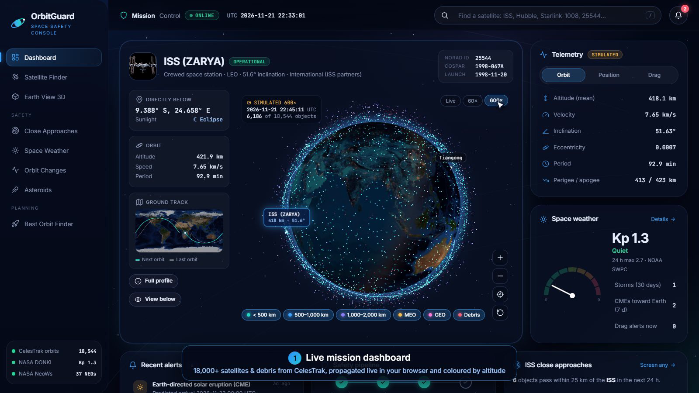

# OrbitGuard demo video

OrbitGuard | ASTRA 2026 | Team AstroNex

[](orbitguard-demo.mp4)

**[orbitguard-demo.mp4](orbitguard-demo.mp4)**: 4 min 44 s, 1600×900, recorded from the live site
(https://orbital-watch-z9bu.vercel.app). It walks through every feature:

| # | Section | Example used |
|---|---|---|
| 1 | Live mission dashboard: 3D globe coloured by altitude, time controls, filters, telemetry, alerts, safety pipeline | ISS |
| 2 | Satellite Finder: search, photo, mission, SATCAT facts, locate on globe | **Hubble Space Telescope (HST)** |
| 3 | Close-approach alerts (SGP4 screening, next 24 h) | HST |
| 4 | NASA DONKI space weather + storm drag alerts, G3 storm simulation | Kp 7 |
| 5 | Earth View 3D: place search in 3D terrain, then ride along under a satellite | **VIT Bhopal University**, HST |
| 6 | Best-orbit recommender, then "your own orbit" ranked against all options | 420 km polar orbit |
| 7 | Orbit changes and near-Earth asteroids | |
| 8 | Custom 404 page | |

The collision-screening wait (about 19 s while SGP4 runs on the server) is fast-forwarded 8×; everything else is real time.

This folder is excluded from the Vercel deployment (`.vercelignore`), and commits that only touch it don't trigger a
rebuild of the website (`vercel.json` → `ignoreCommand`).

## Re-recording

The video is recorded by driving Google Chrome (headless) over the DevTools protocol with real mouse clicks and typing,
then encoding the captured frames with ffmpeg.

```powershell
pip install --target .demo-lib websocket-client imageio-ffmpeg
$env:PYTHONPATH = ".demo-lib"
$env:DEMO_BASE = "https://orbital-watch-z9bu.vercel.app"   # or http://127.0.0.1:5000
python demo/record_demo.py demo-work                         # ~5 minutes
$env:SPEED = "101.8:120.5:8"                                  # optional: fast-forward a waiting span (seconds)
python demo/encode_demo.py demo-work demo/orbitguard-demo.mp4 demo/orbitguard-demo-poster.png 22
```

Warm the site first (open Hubble's profile and run its collision check once) so the video doesn't wait on cold caches.
